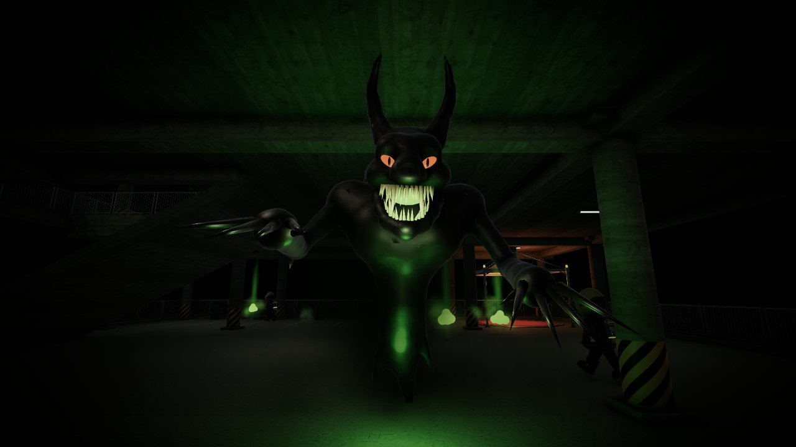
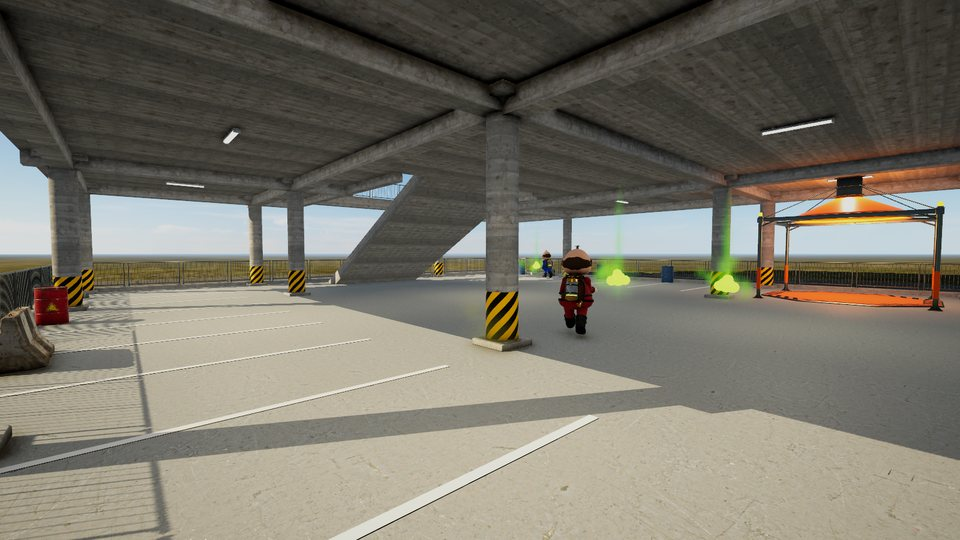
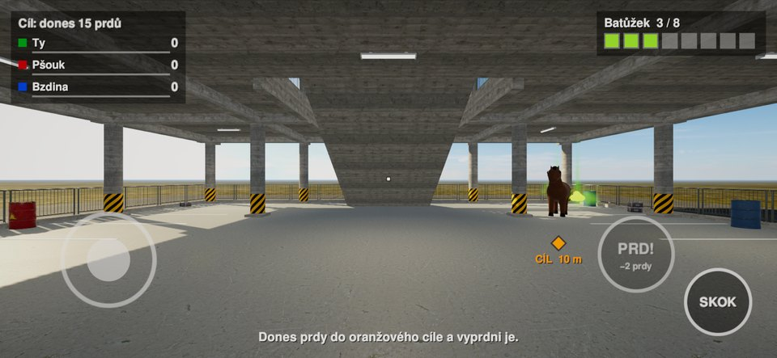

# Prdivý závod 💨 (Fart Race)

A small first-person game made with Unity 6. Run around a four-storey car
park, fill your backpack with floating green farts and expel them at the goal
before the two bots do – or before a second player on another device does.
About 45 seconds in, the lights fail and a fart monster comes up out of the
floor.

Malá hra z pohledu první osoby v Unity 6. Běhej po čtyřpatrovém parkovacím
domě, nasbírej do batůžku zelené prdy a vyprdni je v cíli dřív než oba boti –
nebo než druhý hráč na jiném zařízení. Asi po 45 vteřinách zhasnou světla a
z podlahy vyleze prdová příšera.



| | |
|---|---|
|  |  |

## What is in it / Co ve hře je

- A match for one player and two bots, or **two players on two devices**
  (Wi-Fi; Bluetooth between Android phones) – *hra pro jednoho, nebo pro dva
  hráče na dvou zařízeních (Wi-Fi, mezi telefony i Bluetooth)*.
- Desktop (Linux, Windows, macOS) with keyboard and mouse, **Android** with
  touch controls, plus a lighter build for old phones – *počítač i Android,
  včetně odlehčeného sestavení pro staré telefony*.
- A world built entirely by code, with photographic lighting and PBR
  materials – *svět celý postavený kódem, realistické osvětlení a materiály*.
- 63 real fart recordings; everything the monster says is synthesised –
  *63 skutečných nahrávek prdů; zvuky příšery jsou syntetické*.
- Headless checks: bot matches, scripted touch input, the monster, two-player
  over loopback – *automatické kontroly bez okna*.

## Quick start / Rychlý start

```sh
git clone git@github.com:xjrk58/unity-hra.git
```

1. Install **Unity 6000.4.11f1** with Unity Hub and open the folder.
2. Open `Assets/Scenes/Main.unity`, press **Play**, click **Hrát sám**.
3. **Tools ▸ Prdivý závod ▸ Build player** makes a standalone build in
   `Builds/PrdivyZavod`; **Build Android APK** makes `Builds/Android/PrdivyZavod.apk`.

*Nainstaluj Unity 6000.4.11f1 přes Unity Hub, otevři složku, otevři scénu
`Assets/Scenes/Main.unity`, stiskni Play a zvol „Hrát sám“. Samostatnou hru
sestavíš přes Tools ▸ Prdivý závod.*

## Documentation / Dokumentace

Written the [Diátaxis](https://diataxis.fr) way, in both languages:

| | English | Česky |
|---|---|---|
| Start here | [docs/en](docs/en/index.md) | [docs/cs](docs/cs/index.md) |
| Tutorials | [Your first match](docs/en/tutorials/01-your-first-match.md) · [Build and run from source](docs/en/tutorials/02-build-and-run-from-source.md) | [První zápas](docs/cs/tutorials/01-your-first-match.md) · [Sestavení ze zdrojů](docs/cs/tutorials/02-build-and-run-from-source.md) |
| Build guides | [Linux & Windows](docs/en/how-to/build-for-linux-and-windows.md) · [Mac with Apple silicon (M1…)](docs/en/how-to/build-on-a-mac-with-apple-silicon.md) · [Android](docs/en/how-to/build-the-android-apk.md) · [Old Android phones](docs/en/how-to/build-for-old-android-phones.md) | [Linux a Windows](docs/cs/how-to/build-for-linux-and-windows.md) · [Mac s Apple silicon (M1…)](docs/cs/how-to/build-on-a-mac-with-apple-silicon.md) · [Android](docs/cs/how-to/build-the-android-apk.md) · [Staré telefony s Androidem](docs/cs/how-to/build-for-old-android-phones.md) |
| CI | [Build in GitHub Actions](docs/en/how-to/build-in-github-actions.md) | [Sestavení v GitHub Actions](docs/cs/how-to/build-in-github-actions.md) |
| Playing together | [Play with two players](docs/en/how-to/play-with-two-players.md) | [Hra pro dva](docs/cs/how-to/play-with-two-players.md) |
| Rules and controls | [Gameplay](docs/en/reference/gameplay.md) · [Controls](docs/en/reference/controls.md) | [Pravidla](docs/cs/reference/gameplay.md) · [Ovládání](docs/cs/reference/controls.md) |
| How it works | [The world](docs/en/explanation/how-the-world-is-built.md) · [The monster](docs/en/explanation/the-monster.md) · [Two-player](docs/en/explanation/two-player-design.md) | [Svět](docs/cs/explanation/how-the-world-is-built.md) · [Příšera](docs/cs/explanation/the-monster.md) · [Hra pro dva](docs/cs/explanation/two-player-design.md) |

## Status / Stav

Developed and tested on one Linux computer. The standard Android build has
been played on one phone, alone and as the host of a two-player match over
Wi-Fi. Bluetooth play, the old-phone variant and the macOS and Windows builds
have **not** been run on real devices yet. The honest list is in
[Verification status](docs/en/reference/verification-status.md) /
[Stav ověření](docs/cs/reference/verification-status.md).

## Licence and credits / Licence a poděkování

- Code, tools, generated models, icon and documentation: **MIT** – see
  [LICENSE](LICENSE).
- Textures, sky and scanned props: [Poly Haven](https://polyhaven.com), **CC0**.
- Fart recordings: cut from *"Farts - pieruja"* by **Yle Arkisto**
  ([Freesound #425594](https://freesound.org/people/YleArkisto/sounds/425594/),
  [Wikimedia Commons](https://commons.wikimedia.org/wiki/File:425594_ylearkisto_farts-pieruja.wav)),
  **[CC BY 3.0](https://creativecommons.org/licenses/by/3.0/)** – attribution
  required; changes: cut, mono, filtered, normalised.

Details: [Assets and licences](docs/en/reference/assets-and-licences.md) /
[Assety a licence](docs/cs/reference/assets-and-licences.md).
